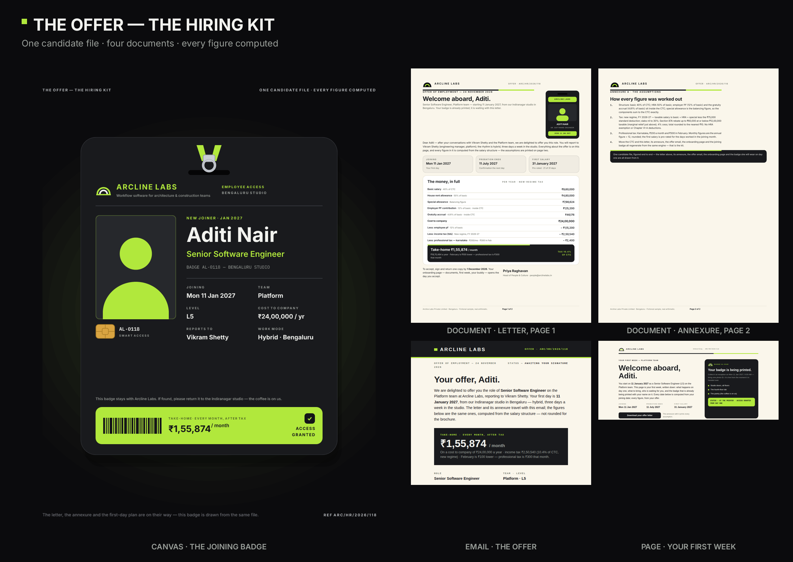
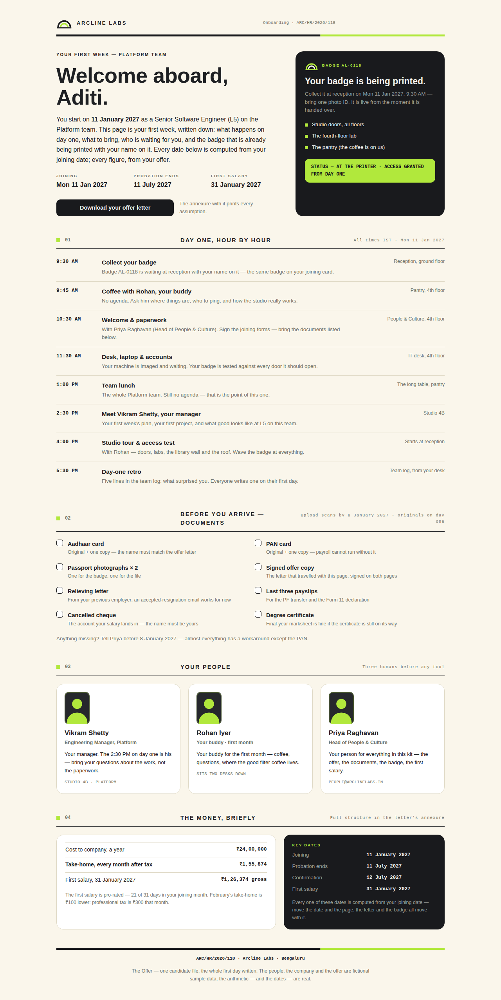

# The Offer — The Hiring Kit

**Access granted.** A complete hiring kit — offer letter, offer email,
onboarding page, and the joining badge itself as the poster — designed
around one object every new hire actually touches: the employee ID badge.
Carbon black, off-white print, one chartreuse signal. And behind the
badge, a real payroll engine: every figure in every document is computed
from the CTC — structure, new-regime tax, rebate, cess, professional
tax — never typed in.



**Live demo:** https://the-offer-the-hiring-kit.vercel.app/
— a working demo, not a gallery: drag the CTC slider (₹8–60 lakh) and all
four documents regenerate in the browser, live, from the same components
and the same engine that produce the PDF and the PNG.

## The story

An offer is the one document a candidate reads ten times — and the one
whose numbers are usually the least checkable. A CTC is announced; the
take-home is a surprise that arrives with the first payslip. The Offer is
the kit an honest hiring team would send instead. One fictional candidate
file — **Aditi Nair**, Senior Software Engineer (Platform, L5), joining
**Arcline Labs**, Bengaluru, on Monday 11 January 2027, at a CTC of
₹24,00,000 — is figured end to end in four formats, and the letter's
annexure prints every assumption behind the arithmetic so the candidate
can check it herself.

## One candidate file in, everything computed out

All four templates render from a single candidate file in `src/data.ts`,
and every figure comes out of the payroll engine in `src/engine.ts` — a
pure function of the CTC, verified by **320 assertions** (`npm run test`),
including a 231-point sweep across the slider range:

- **Structure:** basic 40% of CTC (₹9,60,000 at ₹24L) · HRA 50% of basic ·
  employer PF 12% of basic and gratuity accrual 4.81% of basic, both
  inside the CTC · special allowance is the exact balancing figure
  (₹7,98,624), so the components sum to the CTC to the rupee.
- **Tax, new regime FY 2026-27:** taxable salary less the ₹75,000 standard
  deduction; slabs nil to 30%; **Section 87A rebate** up to ₹60,000 at or
  below ₹12,00,000 taxable, with marginal relief just above; 4% cess;
  total rounded to the nearest ₹10 (§288B). At ₹24L: **tax ₹2,50,540** —
  10.4% of CTC. At ₹12L CTC the tax is **₹0**.
- **Professional tax, Karnataka:** ₹200 a month, ₹300 in February
  (₹2,400 a year) — which is why February's take-home is ₹100 lower, a
  detail the kit states everywhere it prints the monthly figure.
- **Take-home at ₹24L: ₹1,55,874 a month** (TDS ₹20,878/mo), ₹18,70,484 a
  year. At ₹42L the same engine gives tax ₹7,62,090 and take-home
  ₹2,45,959 — drag the demo slider and watch all four documents agree.
- **Dates are computed too:** probation end (joining + 6 months),
  confirmation, the first salary date, and its pro-rated gross
  (21 of 31 days in the joining month → ₹1,26,374) all derive from the
  joining date in the same file.

## The four templates

| Root | Output | What it is |
|---|---|---|
| `Document` (A4, 2 pages) | `out/offer-letter.pdf` | The offer letter — the badge, pocket-sized, at the head of page 1; the full money table; sign-off. Page 2 is Annexure A: the four printed assumptions behind every figure |
| `Email` (600px) | `out/offer-email.html` | The offer email — carbon masthead with the lime strip, take-home hero on carbon, facts grid, the money in short, the ACCESS GRANTED strip, two buttons |
| `Page` (1120px) | `out/onboarding.html` | "Your first week" — badge-activation panel ("your badge is being printed"), day one hour by hour, documents checklist with a computed deadline, your people, the money briefly |
| `Canvas` (1080×1350) | `out/joining-badge.png` | The badge itself — lanyard hardware, portrait, gold smart chip, badge fields, and the lime access strip carrying the barcode and the computed take-home |



## How Hyper Elements is used

- All four roots — `Email`, `Page`, `Document`, `Canvas` — from one
  theme system and a shared component library (arc mark, lanyard
  hardware, portrait, smart chip, barcode, the two-tone ink band, the
  mini badge, money rows). The badge is a composition of `Layer`,
  layout and `Svg`: the lanyard clip, ring, portrait silhouette, chip
  contacts and the barcode (its bar widths derived from the badge
  number) are all drawn, not imaged.
- The Email uses an email-safe translation of the same identity — no
  Svg in email, so the badge becomes its colours: carbon bands, the
  lime strip, the access strip as a ruled panel.
- `validate()` gates the build; the Document renders via `renderPdf()`
  and the Canvas via `renderImage()`, with real Inter / IBM Plex Mono
  font files passed as bytes (the full local fonts — the ₹ glyph is
  missing from the usual subsets, and every figure here needs it).
- The email was checked with `@hyper-elements/email-clients`: **7 client
  previews** (Outlook, Outlook.com, Gmail, Apple Mail, iPhone) are
  generated by the build into `out/email-clients/`.
- **The demo is the same code.** `site/` is a small Vite app that imports
  these exact components and the engine, and calls `render()` in the
  browser — the letter on screen is live text, not a picture of one.

**Validation: 0 errors, 0 warnings on all four templates** (the email
carries 26 informational notes — classic Outlook letter-spacing notes —
nothing broken, as the previews show). Engine: **320/320 assertions**.

## Run it

```bash
npm install
npm test        # the payroll engine's 320 assertions
npm run check   # validate only — 0 errors, 0 warnings
npm run build   # validates, then renders everything into out/

cd site && npm install && npm run dev   # the live CTC-slider demo
```

## Design

"The Badge," in **Carbon & Lime**. The Canvas *is* the employee ID
badge — lanyard clip and split ring at the top, portrait, gold smart
chip, and at the foot the lime access strip: barcode, take-home,
ACCESS GRANTED. Carbon `#191A1D`, off-white `#F2F3EF`, chartreuse
`#B1E83C` as the single signal colour, the chip's gold `#D9A441` the
only other hue — because a real badge's chip is gold. The letter and
the page are the badge translated to paper: ivory `#FAF6EB`, carbon
print, the lime spent sparingly — the two-tone rule (68% carbon, 32%
lime), the take-home panel's edge, the mini badge at the head of the
letter. Inter carries everything; IBM Plex Mono is reserved for badge
numbers, references and figures — the text that is *printed on plastic*
or *counted*.

---

The Offer is fictional. Arcline Labs, Aditi Nair, the team, the offer
and the dates in this template are invented sample data; the arithmetic
— structure, slabs, rebate, professional tax, pro-rating — is real, and
the annexure prints its assumptions. Fonts: Inter, IBM Plex Mono
(SIL OFL — see `assets/fonts/README.md`).
